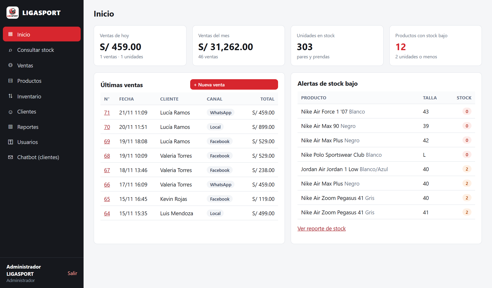
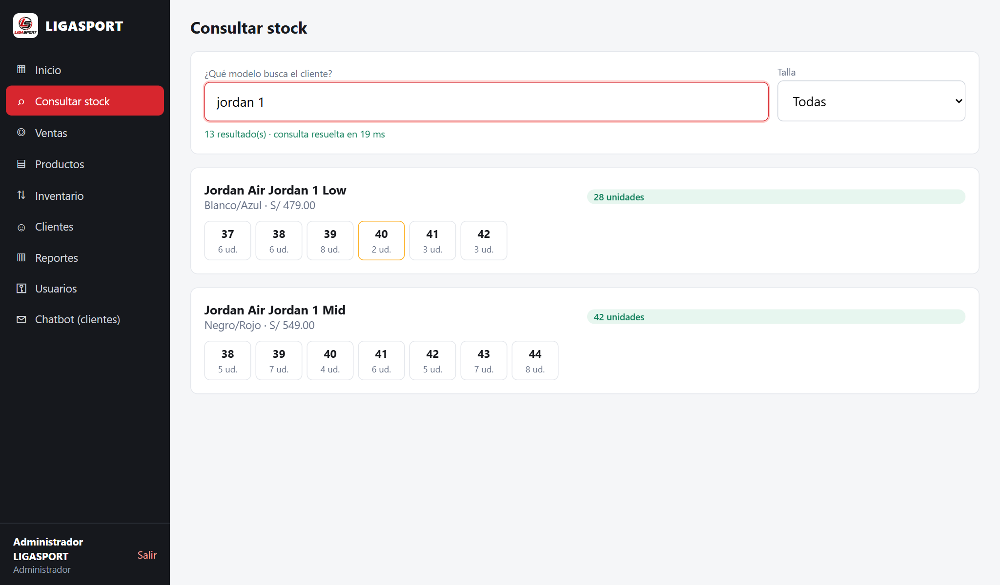
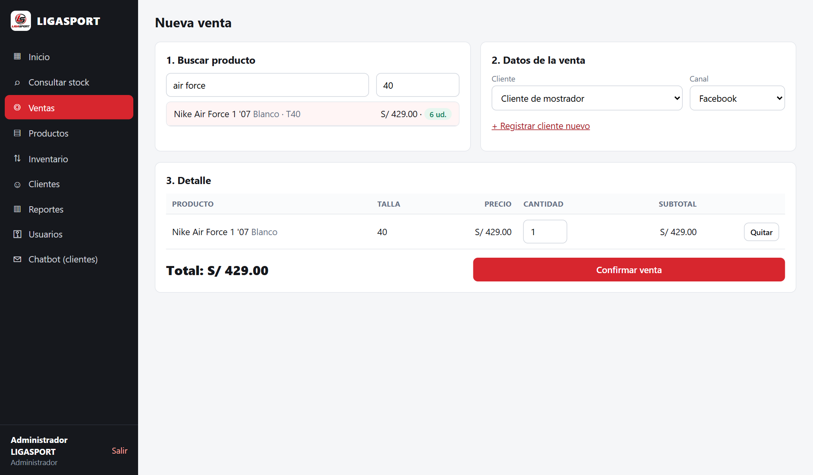
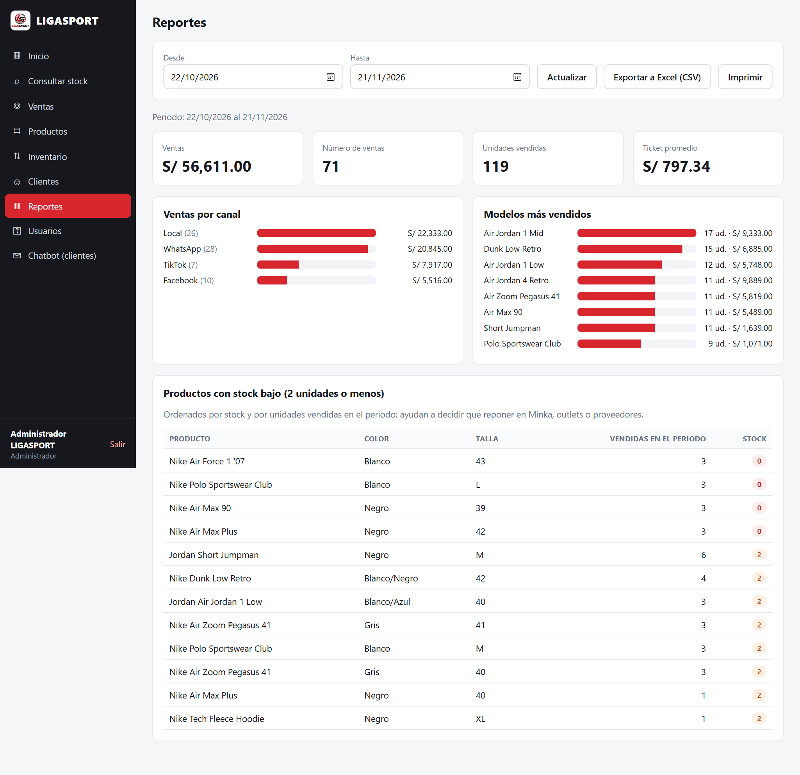
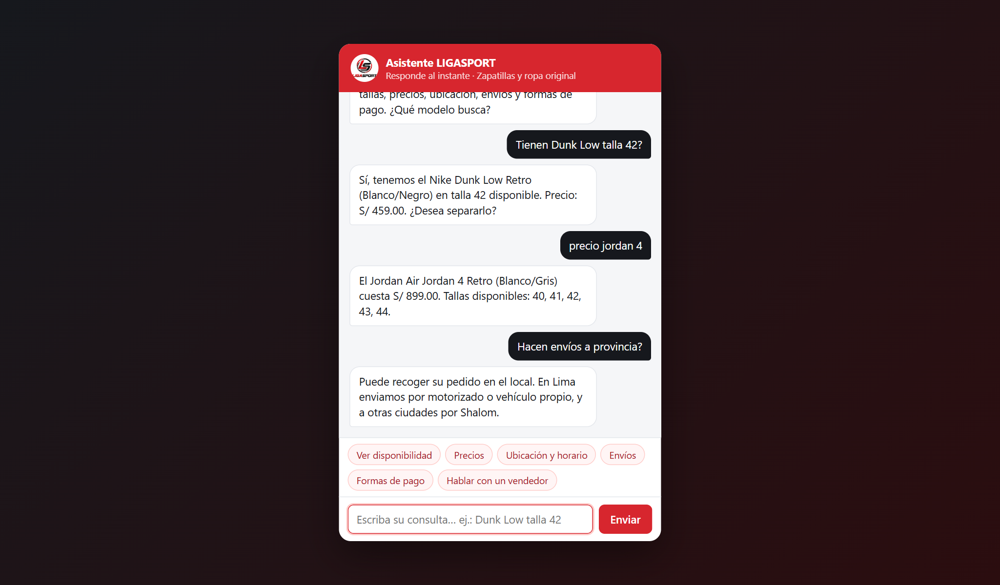

# LIGASPORT · Sistema web de gestión de ventas e inventario

Prototipo funcional del proyecto de innovación **“Implementación de un sistema web para mejorar la gestión de ventas e inventario en la empresa LIGASPORT”** (SENATI · Ingeniería de Software con Inteligencia Artificial · CGEU-241).

LIGASPORT vende zapatillas y ropa originales (Nike y Jordan) en su local de Collique y por TikTok, Facebook y WhatsApp. Antes registraba las ventas en Excel y WhatsApp, y la consulta de stock tomaba unos 12 minutos. Este sistema centraliza **productos, stock, ventas, clientes y usuarios** en una sola base de datos, y suma un **chatbot por reglas** para atender las consultas frecuentes de los clientes.



## Funciones (requerimientos de la tesis)

| Código | Requerimiento | Dónde está |
|---|---|---|
| RF1 | Registrar y consultar productos con marca, modelo, talla, color y precio | `productos.php`, `producto_form.php` |
| RF2 | Registrar entradas y salidas de inventario, actualizando el stock automáticamente | `inventario.php` |
| RF3 | Registrar cada venta con su canal (Local, WhatsApp, Facebook, TikTok) y descontar el stock al confirmarla | `venta_nueva.php`, `ventas.php` |
| RF4 | Consultar el stock por producto y talla desde cualquier equipo | `stock.php`, `api/stock.php` |
| RF5 | Reportes de ventas y de stock por periodo, con exportación a Excel (CSV) | `reportes.php` |
| RF6 | Chatbot por reglas para clientes (reglas del Anexo 2) | `chatbot.php`, `api/chatbot.php` |
| RNF1 | Acceso desde el navegador, sin instalar nada en cada equipo | toda la aplicación |
| RNF2 | Información centralizada en MySQL | `database/ligasport_db.sql` |
| RNF3 | Usuario y contraseña cifrada, con permisos por rol (administrador y vendedor) | `login.php`, `usuarios.php` |

## Tecnologías

HTML, CSS y JavaScript (sin frameworks) · PHP 8 · MySQL / MariaDB · XAMPP para desarrollo local.

## Instalación con XAMPP

1. Inicie **Apache** y **MySQL** desde el panel de XAMPP.
2. Copie la carpeta del proyecto en `C:\xampp\htdocs\ligasport-web`.
3. Importe la base de datos: en phpMyAdmin, pestaña **Importar**, elija `database/ligasport_db.sql`. Desde la consola también funciona:
   ```
   C:\xampp\mysql\bin\mysql.exe -u root < database\ligasport_db.sql
   ```
4. Abra `http://localhost/ligasport-web` en el navegador.

La conexión usa los valores por defecto de XAMPP (`root` sin contraseña). Para otro servidor, edite `config.php` o defina las variables de entorno `LIGA_DB_HOST`, `LIGA_DB_NAME`, `LIGA_DB_USER` y `LIGA_DB_PASS`.

Sin Apache, también se puede usar el servidor integrado de PHP:
```
C:\xampp\php\php.exe -S 127.0.0.1:8000 -t .
```

### Usuarios de demostración

| Rol | Usuario | Contraseña |
|---|---|---|
| Administrador | `admin` | `Admin2026!` |
| Vendedor | `vendedor` | `Vendedor2026!` |

Son credenciales de prueba para la demo local: cámbielas desde **Usuarios** antes de publicar el sistema.

El chatbot es público (no pide iniciar sesión): `http://localhost/ligasport-web/chatbot.php`.

## Base de datos

El script crea las seis entidades del modelo de datos de la tesis (Figura 8): `producto`, `movimiento_inventario`, `venta`, `detalle_venta`, `cliente` y `usuario`. Incluye 62 productos (cada talla es un producto), 9 clientes y 70 ventas de prueba de los últimos 30 días. **Todos los datos son ficticios.**

El stock (`producto.stock_actual`) solo cambia de dos formas: con un movimiento de inventario o con una venta. Las dos operaciones se hacen dentro de una transacción que bloquea la fila del producto, así que el sistema no permite vender más unidades de las que hay.

## Seguridad aplicada

- Consultas preparadas con PDO en todas las operaciones (evita inyección SQL).
- Contraseñas guardadas con `password_hash` (bcrypt).
- Token CSRF en todos los formularios y salida escapada con `htmlspecialchars` (evita XSS).
- Permisos por rol: el vendedor registra ventas, movimientos y clientes; el administrador además gestiona productos, precios y usuarios.

## Capturas

| Consulta de stock (RF4) | Nueva venta (RF3) |
|---|---|
|  |  |
| **Reportes (RF5)** | **Chatbot para clientes (RF6)** |
|  |  |

## Estructura

```
ligasport-web/
├── api/              # servicios JSON (stock y chatbot)
├── assets/           # CSS, JavaScript e imágenes
├── database/         # script SQL con esquema y datos de prueba
├── docs/capturas/    # capturas de pantalla
├── includes/         # conexión, sesión, seguridad y plantilla
├── config.php        # configuración de la base de datos y de la empresa
└── *.php             # páginas del sistema
```

## Autor

Angel Joshban Ventura Coello · Asesor: Jose Ernesto Veliz Tejada · SENATI, Lima, 2026.
